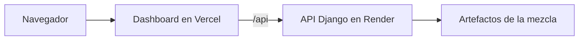
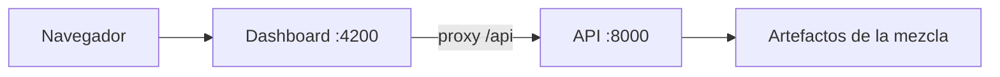
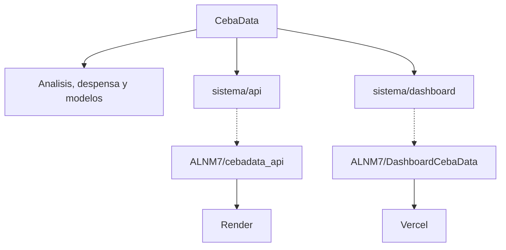

# CebaData — Los Vochos

Repositorio del equipo Los Vochos. Documenta cómo se estimó el rendimiento de parcelas de cebada (t/ha) y trae, como submódulos, la API y el dashboard que consultan esa estimación.

El código que está en línea no se edita aquí. Vive en los repos de backend y de frontend, y este repositorio los fija en un commit para poder clonar el sistema completo.

## Índice

- [Qué es este repositorio](#qué-es-este-repositorio)
- [Arquitectura](#arquitectura)
- [Dashboard en línea](#dashboard-en-línea)
- [Repos de backend y de frontend](#repos-de-backend-y-de-frontend)
- [Ejecutar en local](#ejecutar-en-local)
  - [Requisitos](#requisitos)
  - [Descargar](#descargar)
  - [Linux](#linux)
  - [macOS](#macos)
  - [Windows](#windows)
- [Historia](#historia)

## Qué es este repositorio

CebaData guarda el proceso: el análisis, la despensa de datos, la exploración de modelos y la ficha del modelo firmado (la **mezcla**). El sistema que se consulta —API y dashboard— entra como dos submódulos en `sistema/`.

```text
analisis/                 Exploración en R
dataset_entrenamiento/    Despensa y CSVs curados
modelos/                  Exploración y ficha de la mezcla
sistema/api               Submódulo: API Django y pipeline
sistema/dashboard         Submódulo: dashboard Angular
docs/                     Cómo se publicó y propuestas a esos repos
INSTALACION.md            Detalle de instalación y fallos frecuentes
DATASET_RETO_AGRO_2026/   Dataset oficial (no se altera)
```

Hay 197 parcelas (`AGC_001` … `AGC_197`). 138 tienen rendimiento observado del ciclo abril–octubre de 2025 y 59 no. La mezcla estima esas 59. La API no reentrena: al arrancar carga artefactos congelados de unos 2 MB.

## Arquitectura

La mezcla promedia dos predicciones. Una es un ensamble de LightGBM, bosque aleatorio y red elástica. La otra es un LightGBM que solo usa la longitud. Cada miembro del ensamble pesa un sexto y el modelo de longitud pesa un medio, así que el resultado es el promedio simple de los dos bloques. La ficha está en [`modelos/entrega/`](modelos/entrega/).

Django lee esos artefactos y responde en `/api`. No hay base de datos. El dashboard, en Angular, pide ese prefijo y no guarda una URL de API en el código.

En línea, Vercel publica el dashboard y reescribe `/api` hacia Render:



En local el mismo contrato lo cumple el proxy de `ng serve`: `/api` va a Django en el puerto 8000.



Este repositorio envuelve las dos piezas y deja el resto del proceso al lado:



Los submódulos apuntan a commits fijos (`9d64758` la API, `aa766ad` el dashboard). Un cambio del sistema se hace en el repo de ALNM7; cuando se integra, aquí solo se mueve el puntero. La historia del despliegue está en [`docs/CAMINO_A_HOSTING.md`](docs/CAMINO_A_HOSTING.md).

## Dashboard en línea

https://dashboard-ceba-data.vercel.app/

Desde ahí se consultan el mapa, la ficha de cada parcela, las métricas y el simulador. El dashboard habla con la API en https://cebadata-api.onrender.com. La salud de esa API es https://cebadata-api.onrender.com/api/salud.

El plan gratuito de Render apaga el proceso si nadie lo visita. La primera carga puede tardar cerca de un minuto mientras despierta. El dashboard en Vercel responde al instante; lo que espera es la API.

## Repos de backend y de frontend

Estos son los repos operativos. El que está publicado es el de cada plataforma, no una copia editada dentro de CebaData.

| Pieza | Repositorio | En línea |
| --- | --- | --- |
| Backend (Django) | https://github.com/ALNM7/cebadata_api | https://cebadata-api.onrender.com |
| Frontend (Angular) | https://github.com/ALNM7/DashboardCebaData | https://dashboard-ceba-data.vercel.app/ |

En este árbol quedan en `sistema/api` y `sistema/dashboard`. El listado de rutas (`/api/salud`, `/api/parcelas`, `/api/metricas`, `/api/simular`, `/api/predecir`) está en el README de la API.

## Ejecutar en local

Hace falta git, Python 3.12 o superior y Node 20.19 o superior (o 22.12 o superior), con npm. El repo de la API declara Python 3.13; las pruebas también pasan en 3.12.

El ZIP de GitHub no trae los submódulos. Hay que clonar con git. Los dos repos de ALNM7 tienen que ser públicos, o hace falta acceso a ellos.

### Descargar

```bash
git clone --recurse-submodules https://github.com/Dualironboy12/CebaData-LosVochos.git
cd CebaData-LosVochos
```

Si `sistema/api` o `sistema/dashboard` quedaron vacíos:

```bash
git submodule update --init
```

Al terminar, la API queda en http://127.0.0.1:8000/api/salud y el dashboard en http://127.0.0.1:4200. El dashboard también reenvía `/api`, así que http://127.0.0.1:4200/api/salud tiene que responder igual. Más fallos frecuentes: [`INSTALACION.md`](INSTALACION.md).

### Linux

Desde la raíz:

```bash
bash scripts/levantar_local.sh
```

El script crea `sistema/api/.venv`, instala las dependencias de la API, corre `npm ci` en el dashboard si aún no hay `node_modules`, levanta Django en el puerto 8000 y, cuando `/api/salud` responde, arranca Angular en el 4200. Ctrl+C detiene los dos.

### macOS

Sirve el mismo script si `python3` es 3.12 o superior:

```bash
bash scripts/levantar_local.sh
```

Si el sistema no tiene esa versión en `/usr/bin/python3` (en macOS a menudo está en Homebrew), levanta los dos procesos a mano. En una terminal:

```bash
cd sistema/api
python3 -m venv .venv
source .venv/bin/activate
pip install -r requirements.txt
DJANGO_DEBUG=1 \
CORS_ALLOWED_ORIGINS="http://localhost:4200,http://127.0.0.1:4200" \
python manage.py runserver 127.0.0.1:8000
```

En otra:

```bash
cd sistema/dashboard
npm ci
npm start -- --host 127.0.0.1 --port 4200
```

### Windows

El script de Linux usa bash y rutas de Unix. En Windows el camino corto es WSL: dentro de Ubuntu se siguen los pasos de [Linux](#linux).

En PowerShell, sin WSL, son dos terminales. En la primera:

```powershell
cd sistema\api
py -3.12 -m venv .venv
.\.venv\Scripts\Activate.ps1
pip install -r requirements.txt
$env:DJANGO_DEBUG = "1"
$env:CORS_ALLOWED_ORIGINS = "http://localhost:4200,http://127.0.0.1:4200"
python manage.py runserver 127.0.0.1:8000
```

Si PowerShell bloquea `Activate.ps1`, en esa misma ventana: `Set-ExecutionPolicy -Scope Process -ExecutionPolicy Bypass`.

En la segunda, desde la raíz del clon:

```powershell
cd sistema\dashboard
npm ci
npm start -- --host 127.0.0.1 --port 4200
```

## Historia

El detalle de cada decisión y de los prompts está en [`PROMPTS.md`](PROMPTS.md) y en [`docs/CAMINO_A_HOSTING.md`](docs/CAMINO_A_HOSTING.md).

A finales de septiembre de 2026 el equipo fijó tres fases: análisis en R, modelos en Python y una interfaz. En los días siguientes se exploró el dataset oficial y dos fuentes públicas (INEGI y SoilGrids), se congeló una despensa y se comparó un catálogo amplio de modelos clásicos. Los datos externos se midieron y no entraron en la entrega.

En paralelo, Alfredo armó un pipeline sobre el dataset oficial y un dashboard, primero en JavaScript y luego en Angular, con una API que solo carga artefactos. El 13 de octubre se firmó la mezcla: empata al ensamble donde importa el error y aguanta mejor un municipio que el modelo no vio. Una prueba pareada contra el ganador del barrido anterior no justificó cambiarla.

Ese mismo día la API y el dashboard entraron a este repositorio para tener un solo clon. Render y Vercel despliegan un servicio por repo, así que el 18 de octubre volvieron a [cebadata_api](https://github.com/ALNM7/cebadata_api) y [DashboardCebaData](https://github.com/ALNM7/DashboardCebaData). CebaData se quedó como documentación del proceso y como envoltorio de esos dos submódulos.
